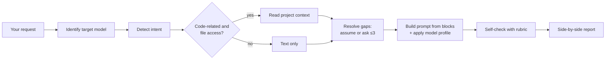

# crafting-prompt

**Turn rough, conversational requests into precise prompts tuned for the LLM you're using.**

`crafting-prompt` is an [Agent Skill](https://docs.claude.com/en/docs/agents-and-tools/agent-skills/overview)
that reads what you typed, works out what you actually want (bug fix, research, refactor,
roadmap, …), looks at your codebase for context, and returns a copy-ready prompt shaped for
your target model — with a side-by-side comparison so you can see exactly what improved.


---

## Before → after

You type:

```text
/crafting-prompt users keep getting logged out randomly, fix it
```

You get:

```text
<context>
Next.js 14 (App Router) + TypeScript app using next-auth 4.24 with JWT sessions.
Auth config: src/lib/auth.ts. Route protection: src/middleware.ts.
Users report being logged out at random times — our top support complaint.
</context>

<task>
Find the root cause of the unexpected logouts and fix it.
</task>

<approach>
1. Check session maxAge / updateAge, JWT refresh logic, cookie settings, and whether the
   middleware treats a token-refresh window as "unauthenticated".
2. Explain the root cause in 2–3 sentences before changing code.
3. Make the smallest change that fixes it.
</approach>

<constraints>
- Keep the JWT session strategy and the public auth API.
</constraints>

<success_criteria>
- A Vitest test reproduces the logout and passes after the fix.
- `pnpm test` and `pnpm lint` pass.
</success_criteria>
```

…followed by a **What changed** table and a **quality score** for each version:

| | Clarity | Context | Scope | Constraints | Output | Done-when | Verification | Model fit | **Total** |
|---|---|---|---|---|---|---|---|---|---|
| Original | 1 | 0 | 0 | 0 | 0 | 0 | 0 | 0 | **1/16** |
| Crafted | 2 | 2 | 2 | 2 | 2 | 2 | 2 | 2 | **16/16** |

The stack, versions, file paths and test commands above came from reading the project —
not from guessing. See [examples/examples.md](examples/examples.md) for full runs covering
research, roadmaps and cleanup across different models.

---

## Features

- **Intent detection**: research, new feature, bug fix, refactor/cleanup, optimization,
  roadmap, code review, tests, docs, migration, explanation — and mixed requests.
- **Codebase-aware**: reads project instructions (`CLAUDE.md`, `AGENTS.md`, `.cursorrules`…),
  manifests (`package.json`, `pyproject.toml`, `go.mod`, `pom.xml`, …) and the files you
  mention, so the prompt names real paths, versions and test commands.
- **Model-tuned output**: a different shape for each model family (XML for Claude, Markdown
  for GPT, goal-only for reasoning models, context-first for Gemini, flat and short for
  small local models, work-steering for coding agents).
- **Visible difference**: original vs. crafted side by side, a "what changed" table, and an
  honest 0–16 quality score.
- **No silent guessing**: assumptions are listed so you can correct them; at most three
  questions are asked, and only when a gap blocks a usable prompt.
- **Safe by default**: never copies secrets or `.env` values into a prompt and never widens
  the scope of what you asked.

## Supported targets

| Target | Prompt style |
|---|---|
| **Claude** (Opus, Sonnet, Haiku) | XML-tagged sections, long context first, explicit act-vs-suggest, reasons behind rules |
| **GPT** (GPT-4.1, GPT-4o, GPT-5…) | Markdown sections, no contradictions, persistence/tool/planning reminders for agents |
| **Reasoning models** (o-series, high-effort GPT-5) | Short: goal, constraints, output format; no "think step by step" |
| **Gemini** (Pro, Flash) | Context first, instruction last, explicit format prefix, few-shot examples |
| **Open-weight** (Llama, Mistral, Qwen, Gemma, Phi…) | Flat numbered rules, inline context, key rule repeated at the end |
| **DeepSeek R1** and similar | Everything in the user message, zero-shot, clear final-answer format |
| **Coding agents** (Claude Code, Codex, Cursor, Copilot, Gemini CLI, Windsurf, Aider) | File paths instead of pasted code, plan-vs-implement mode, verification commands, stop conditions |
| **Unknown** | A generic profile that works acceptably everywhere |

If you don't name a target, the skill uses the model it is running on.

---

## Installation

### Claude Code

Personal (available in every project):

```bash
git clone https://github.com/<your-username>/crafting-prompt.git ~/.claude/skills/crafting-prompt
```

Project-only (commit it so your team gets it too):

```bash
git clone https://github.com/<your-username>/crafting-prompt.git .claude/skills/crafting-prompt
```

On Windows PowerShell, use `$HOME\.claude\skills\crafting-prompt` as the target path.
Restart Claude Code (or start a new session) and the skill is available.

### Claude.ai / Claude desktop

1. Download this repository as a ZIP (or zip the `crafting-prompt` folder, with
   `SKILL.md` at its top level).
2. Open **Settings → Capabilities → Skills** and upload the ZIP.

### Other agents that support Agent Skills

Many coding agents now read the same `SKILL.md` format. Copy or clone this folder into that
tool's skills directory (check its documentation for the path). The skill uses no
vendor-specific tools — it only needs to read text and, optionally, files.

### Any chat LLM (ChatGPT, Gemini, local models)

No skill support? Paste the contents of `SKILL.md` plus `references/model-profiles.md`
and `references/task-templates.md` into the system prompt / custom instructions (a Custom
GPT, a Gemini Gem, an Open WebUI or LM Studio system prompt). Then send your rough
request, starting with "crafting-prompt:". Without file access it crafts from your text
alone and says so.

---

## Usage

```text
/crafting-prompt <your request in plain words> [flags]
```

Or just ask in natural language: *"turn this into a good prompt for Gemini: …"*,
*"improve my prompt"*, *"make what we just discussed into a prompt"*.

| Flag | What it does |
|---|---|
| `--target <model>` | Target a specific model or tool: `claude`, `gpt-5`, `o3`, `gemini`, `llama`, `cursor`, … |
| `--no-context` | Skip reading the codebase |
| `--short` | Most compact prompt that still works; trimmed report |
| `--explain` | Explain each prompting technique used and why it suits the target |

Examples:

```text
/crafting-prompt add dark mode to the settings page
/crafting-prompt --target gpt-5 the checkout API is slow under load, figure out why
/crafting-prompt --target o3 --no-context compare Postgres vs DynamoDB for our event store
/crafting-prompt --target llama --short write tests for app/billing.py
/crafting-prompt make a roadmap for adding multi-tenancy
```

After the result, you can ask it to **run the prompt now**, **adjust** it, or
**re-target** it for another model.

### What you get back

1. **Original** — your text, verbatim
2. **Crafted prompt** — one copy-ready block
3. **What changed** — dimension by dimension
4. **Prompt quality score** — original vs. crafted, 0–16
5. **Assumptions** — what it assumed, so you can correct it
6. **Context used** — which files it read and what it took from them
7. **Suggestions** — related issues or questions that would sharpen it further

---

## How it works



The prompt is assembled from building blocks — Role, Context, Task, Inputs, Scope,
Constraints, Approach, Output format, Done when, Verification, Assumptions — and only the
blocks that add information are kept. The target's profile then decides the delimiters,
ordering, verbosity and reasoning guidance.

## Repository layout

```text
crafting-prompt/
├── SKILL.md                     # The skill: workflow and output format
├── references/
│   ├── model-profiles.md        # Per-model-family prompting rules
│   └── task-templates.md        # Per-intent checklists
├── examples/
│   └── examples.md              # Full before/after runs
├── README.md
└── LICENSE
```

## Customizing

- **Add or update a model**: add a section to
  [references/model-profiles.md](references/model-profiles.md) with *Structure*,
  *Instructions* and *Avoid* subsections. Model guidance changes often — when a vendor
  guide disagrees with a profile, the vendor wins.
- **Add an intent**: add a row to the intent table in `SKILL.md` (Step 3) and a checklist
  to [references/task-templates.md](references/task-templates.md).
- **Change the report**: edit the layout in Step 7 of `SKILL.md`.

## FAQ

**Does it run my task?**
No — it writes the prompt. It offers to run it afterwards if you want.

**Will it send my code anywhere?**
It only reads files locally through your agent, the same way the agent normally does. It
never puts secrets, keys or `.env` values into the prompt. Review a prompt before you paste
it into a different service.

**Why does it ask me questions sometimes?**
Only when something essential is missing (for example, "fix the bug" with no hint which
bug). Otherwise it makes an assumption and lists it.

**The prompt is too long for a simple request.**
Use `--short`. The skill is meant to stay proportional; please open an issue with the
example if it doesn't.

## Contributing

Issues and pull requests are welcome — especially new model profiles, intent templates and
before/after examples. Please include a real (anonymized) input and the output you
expected.

## License

[MIT](LICENSE)
